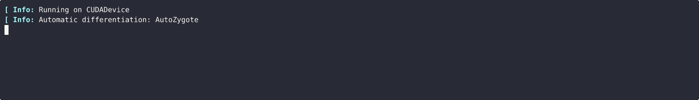
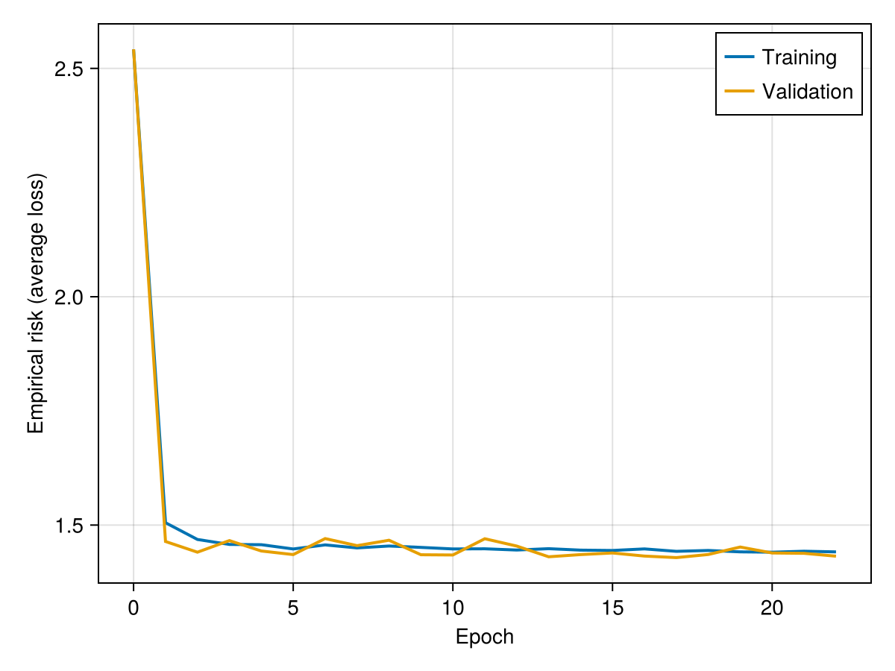
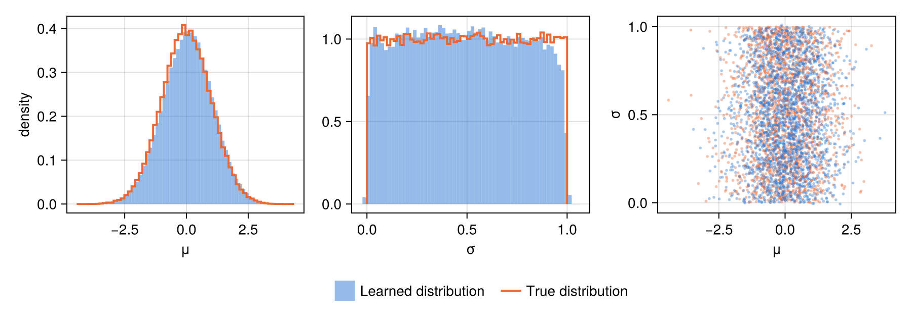

# Learning a prior distribution

Neural estimators are usually trained with parameters drawn from a known prior distribution. Sometimes, however, prior knowledge comes in the form of samples: for example, parameter estimates from many previous analyses of related data, or posterior draws from an earlier analysis (e.g., [Schmidli et al., 2014](https://doi.org/10.1111/biom.12242); [Roch and Shen, 2026](https://arxiv.org/abs/2509.14911)).

Here, we use a [`PriorEstimator`](@ref) to fit a flexible distribution to such samples (i.e., unconditional density estimation). The trained estimator can be used to sample from the learned distribution (e.g., to simulate training data for another neural estimator), to evaluate its density (e.g., as the prior of a [`RatioEstimator`](@ref)), and to map parameters to the latent space of a normalising flow, where unusual parameter vectors can be flagged.

## Package dependencies

```julia
using NeuralEstimators
using Flux
using CairoMakie
using Distributions: Chisq, quantile
```

To improve computational efficiency, various GPU backends are supported. Once the relevant package is loaded and a compatible GPU is available, it will be used automatically:

::: code-group

```julia [NVIDIA GPUs]
using CUDA, cuDNN
```

```julia [AMD ROCm GPUs]
using AMDGPU
```

```julia [Metal M-Series GPUs]
using Metal
```

```julia [Intel GPUs]
using oneAPI
```

:::

## Samples from the target distribution

In practice, the samples would be, for example, existing parameter estimates, stored as a $d$ × $K$ matrix (or a [`NamedMatrix`](@ref)), where $d$ is the dimension of the parameter vector and $K$ is the number of samples. Here, for illustration, we draw them from a known distribution, $\mu \sim N(0, 1)$ and $\sigma \sim U(0, 1)$ independently, so that the learned distribution can be compared with the truth:

```julia
sampler(K) = NamedMatrix(μ = randn(K), σ = rand(K))
θ_train = sampler(100_000)
θ_val   = sampler(100_000)
d = size(θ_train, 1)  # dimension of the parameter vector
```

!!! note "Standardising the parameters"
    A `PriorEstimator` does not standardise the parameters. When they are on very different scales, standardise each parameter before training (e.g., subtract its mean and divide by its standard deviation, both computed from the training samples), and apply the inverse transformation to samples from the learned distribution.

## Constructing the estimator

By default, a [`PriorEstimator`](@ref) approximates the distribution with a [`NormalisingFlow`](@ref). Other [Approximate distributions](@ref) can be used through the keyword argument `q`:

```julia
estimator = PriorEstimator(d)
```

## Training the estimator

We train the estimator with [`train`](@ref), passing the training and validation samples. No data or simulator are needed:

```julia
estimator = train(estimator, θ_train, θ_val; batchsize = 256)
```

Training progress is reported in the terminal:



If new samples can be drawn at will, one may instead pass the function that draws them, `train(estimator, sampler; K = 100_000)`, in which case new samples are drawn during training.

The risk is the average of $-\log q(\boldsymbol{\theta})$ over the samples, where $q$ denotes the density of the learned distribution. Since the samples are drawn from the true distribution, with density $p$, the expected risk decomposes as

```math
\mathbb{E}_p[-\log q(\boldsymbol{\theta})] = \underbrace{\mathbb{E}_p[-\log p(\boldsymbol{\theta})]}_{H(p)} + \underbrace{\mathbb{E}_p\left[\log \frac{p(\boldsymbol{\theta})}{q(\boldsymbol{\theta})}\right]}_{\mathrm{KL}(p \,\|\, q)},
```

where $H(p)$ is the (differential) entropy of $p$ and $\mathrm{KL}(p \,\|\, q)$ is the Kullback–Leibler (KL) divergence from $q$ to $p$. Since $H(p)$ does not depend on $q$, minimising the expected risk is equivalent to minimising the KL divergence. Since the KL divergence is non-negative and zero if and only if $q = p$ (almost everywhere), the expected risk is bounded below by $H(p)$, with equality if and only if $q = p$. Here, since $\mu$ and $\sigma$ are independent, $H(p)$ is the sum of the entropies of their distributions, $N(0, 1)$ and $U(0, 1)$, namely $\frac{1}{2}\log(2\pi e) + 0 \approx 1.42$.

The risk over the course of training can be plotted using [`plotrisk`](@ref):

```julia
plotrisk()
```



## Assessing the estimator

The function [`assess`](@ref) compares draws from the learned distribution with test samples from the true distribution. The resulting [`Assessment`](@ref) contains the risk, here the average negative log density of the test samples under the learned distribution, which estimates the expected risk discussed above. The draws can be visualised with `plot(assessment)`, which compares the marginal distributions of $\mu$ and $\sigma$ and their joint distribution:

```julia
θ_test = sampler(100_000)               # test samples from the true distribution
assessment = assess(estimator, θ_test)  # compares 100,000 draws from the learned distribution with θ_test
risk(assessment)                        # ≈ 1.44, slightly above its lower bound H(p) ≈ 1.42
plot(assessment)
```



The learned distribution closely matches the true distribution. Since a normalising flow is a smooth transformation of a Gaussian distribution, it slightly smooths the sharp boundaries of the uniform distribution of $\sigma$: for parameters with bounded support, it can help to train on an unbounded scale (e.g., after a logit or log transformation) and to transform the samples back.

With three or more parameters, `plot(assessment)` gives a pairs plot, and `plot(assessment; plots = :marginals)` gives the marginal histograms alone. If no test samples are available, `assess(estimator)` can be used to visualise the learned distribution alone.

## Evaluating the learned distribution

The density of the learned distribution is evaluated with [`logdensity`](@ref), and [`forward`](@ref) and [`inverse`](@ref) map between the parameter space and the latent space of the normalising flow:

```julia
θ = sampler(5)
logdensity(estimator, θ)   # log density of each parameter vector
U = forward(estimator, θ)  # latent representation of each parameter vector
inverse(estimator, U) ≈ θ  # the flow is invertible
```

For parameter vectors drawn from the learned distribution, the latent representation is standard Gaussian, so that its squared norm approximately follows a $\chi^2_d$ distribution. This gives a simple check for parameter vectors that are unusual under the learned distribution:

```julia
θ_new = NamedMatrix(μ = [0.1, -1.2, 8.0], σ = [0.5, 0.2, 0.5])  # the third vector is unusual
U = forward(estimator, θ_new)
r² = vec(sum(abs2, U; dims = 1))
r² .> quantile(Chisq(d), 0.999)  # flags the third vector
```
